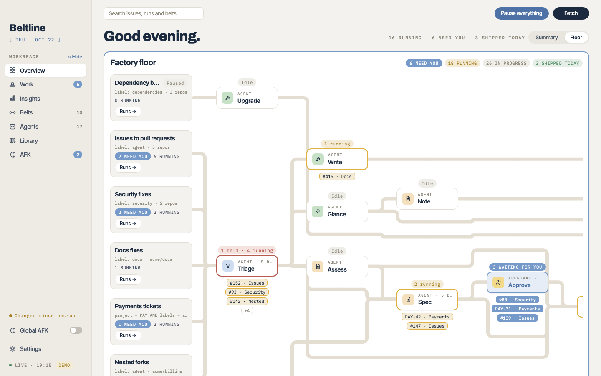

# Beltline

Beltline turns GitHub issues, pull request reviews and Jira tickets into pull requests, using the coding agents you already have. Each work item rides a **belt** of small stages. Agents triage, spec, build, verify and open the pull request; approvals wait for your decision; and a watch waits for the merge. Every stage ends in a named outcome, and you decide what each outcome does next.

It runs on your own machine, macOS or Linux: `beltlined` is a small daemon that runs your belts whether or not a window is open, and you work with it in your browser.



> [!WARNING]
> Beltline runs coding agents (Claude Code, Codex, Copilot, Cursor, Pi) **with their approval prompts turned off**, as your user and with your `gh` and `acli` sign-ins. Agents read issue and ticket text that other people may have written. Read [docs/security.md](docs/security.md) before you point a belt at a repository, and start with a label only you can apply.

## Requirements

- macOS 15 or later, or Linux with systemd (Ubuntu 22.04, Debian 12, Fedora 39 or similar), on arm64 or x86-64. On Windows, run the Linux build in WSL2.
- [`gh`](https://cli.github.com), signed in, together with `git` and `tmux`.
- To build it: Go (the version in `daemon/go.mod`), Node.js LTS and `make`.
- At least one agent CLI, signed in: Claude Code (`claude`), Codex CLI (`codex`), Copilot CLI (`copilot`), Cursor CLI (`cursor-agent`) or Pi (`pi`).
- For Jira belts, Atlassian's `acli`, signed in.

## Install

Beltline installs from this repository's `main` branch; there are no packaged releases.

```sh
git clone https://github.com/robbertmanders/beltline.git
cd beltline
make install                    # build build/release/beltlined and start it now and at every login (a LaunchAgent on macOS, a systemd user service on Linux)
build/release/beltlined open    # sign your browser in and open it
```

Keep the clone where it is: the service starts `build/release/beltlined` from it. Put that folder on your `PATH` to run `beltlined` by name.

To upgrade, pull `main` and install again: `git pull && make install && build/release/beltlined restart`.

On Linux, the service stops when you log out unless you run `loginctl enable-linger "$USER"` once. See [docs/configuration.md](docs/configuration.md#running-at-login) for both systems and for WSL2.

## Try it without touching anything

```sh
make demo
```

This starts a separate daemon on fixture belts, runs, issues and pull requests in a temporary folder, without GitHub, Jira or agents. Ctrl-C stops it and removes the folder.

## First steps

A fresh install has no belts and no agents. To set up your first belt:

1. In **Settings → Tools**, check that `gh`, `git`, `tmux` and your agent CLIs are found. In **Settings → Allowed models**, allow the models your agents may use.
2. On **Belts**, open **Agent** and describe what you want, for example: *"a belt for issues labelled `agent` in owner/repo: triage, spec, build, verify, ship, then wait for the merge"*. The configuration assistant adds the built-in agents and writes the belt for you. You can also build one by hand with **New belt**.
3. Label an issue and watch it come in on the **Overview**. Runs that need you are listed under **Needs you** and on **Work**.

If your team keeps belts and agents in a git repository, add it in **Settings → Library repositories** and install them from **Library**.

## Documentation

The documentation is at **[robbertmanders.github.io/beltline](https://robbertmanders.github.io/beltline/)**, and in [`docs/`](docs/) in this repository:

- [Your first belt](docs/first-belt.md): set up a belt for your own repository
- [Concepts](docs/concepts.md): belts and triggers, stages, outcomes and forks, watches, and working with runs
- [Agents](docs/agents.md): the agent file, briefs and placeholders, and the built-in agents
- [Runners and models](docs/runners.md): the agent CLIs, allowed models and thinking levels
- [AFK mode](docs/afk.md), [Library](docs/library.md), [Shadow tests](docs/shadow-tests.md) and [Insights](docs/insights.md)
- [Configuration](docs/configuration.md): the data folder, environment variables, running at login and the configuration assistant
- [Security model](docs/security.md): what agents can do, the local server's checks and how to run Beltline safely
- [Development](docs/development.md) and [CONTRIBUTING.md](CONTRIBUTING.md): building from source, the tests and the architecture

Beltline sends no telemetry. The only network calls are the ones `gh`, `acli`, `git` and your agent CLIs make for it.

## Contributing

Issues and pull requests are welcome. See [CONTRIBUTING.md](CONTRIBUTING.md), and report security problems privately as [SECURITY.md](SECURITY.md) describes. Everyone taking part follows the [code of conduct](CODE_OF_CONDUCT.md).

## License

Beltline is licensed under the [Apache License 2.0](LICENSE). It includes third-party software under its own licenses, listed in [THIRD_PARTY_NOTICES](THIRD_PARTY_NOTICES).
