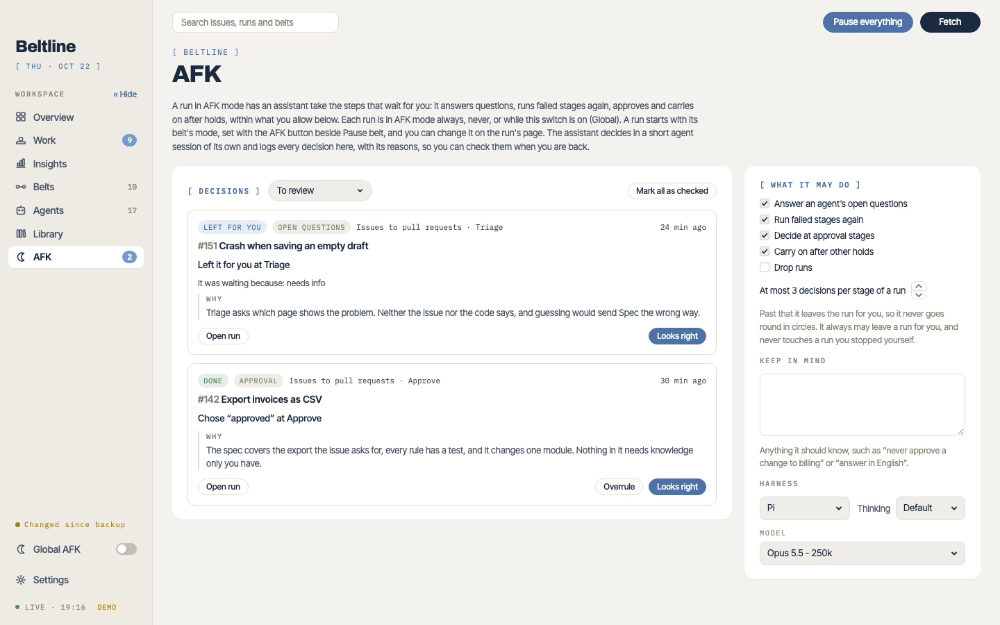

# AFK mode
{: .no_toc }

While you're away from the keyboard, AFK mode has an agent take the steps that wait for you: it answers questions, runs failed stages again, approves, and carries on after holds, within what you allow.
{: .lead }

1. TOC
{:toc}

{: .warning }
The deciding agent runs with the same full permissions as every other agent. The allowances limit *what it may choose*, not what it can do on your machine. Only turn AFK on for belts whose triggers you trust. See the [security model](security.md#afk-mode-decides-on-your-behalf).

## Turning it on

Each run is in AFK mode **always**, **never**, or **global**, which follows the **Global AFK** switch at the bottom of the sidebar. A new run starts with its belt's mode, which you set with the **AFK** button beside **Pause belt**, and you can change it on the run's page.

## What it may do

**What it may do**, on the AFK page, sets what the deciding agent may choose:

| Allowance | Default | What it allows |
| --- | --- | --- |
| Answer an agent's open questions | on | Continue a held agent's session with an answer. |
| Run failed stages again | on | Run a failed stage again, or continue its session with advice. |
| Decide at approval stages | on | Pick an approval's outcome. |
| Carry on after other holds | on | After any other hold, such as a watch that saw something its outcomes don't handle or an outcome past its limit: run the stage again or send the run to another stage. |
| Drop runs | off | Drop a run, or pick an approval outcome that drops it. |

It may always leave a run for you. It decides at most a set number of times (3 by default) at one stage of one run, and then leaves the run for you, so it never goes round in circles. It never touches a run you stopped yourself, and a decision for a run that moved on in the meantime is dropped.

**Keep in mind** is guidance it reads every time, such as "never approve a change to billing" or "answer in English". You also choose its harness, model and thinking.

## Checking its decisions

Each decision is a short agent session that writes its choice and its reasons. The **AFK** page lists every decision until you mark it as checked: what it chose, at which stage, and why.

- **Looks right** marks a decision as checked. **Mark all as checked** does them all.
- **Overrule** disagrees with a decision that was applied: it restarts the run at an agent stage you choose, with your comments for it.
- **Open run** opens the run.

Decisions are also marked on the attempt they ended, on the run's page.
