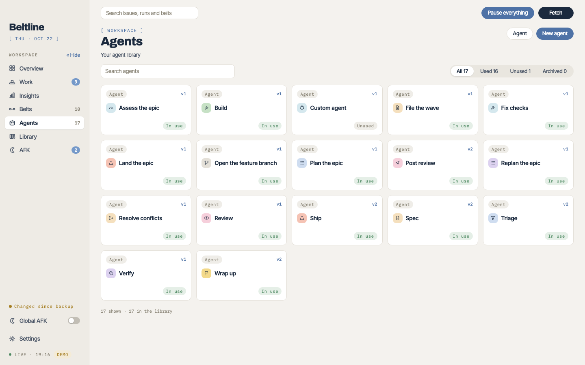

# Agents
{: .no_toc }

An agent is a reusable stage definition: which runner and model it uses, where it works, its brief and its outcomes. It lives in your library as one Markdown file per version.
{: .lead }

1. TOC
{:toc}

## The Agents page

**Agents** lists your library as cards, filtered to used, unused or archived. Open one to edit it, or choose **New agent**. Every save is a new version, and a saved version never changes: a belt's stage pins the version it was saved with, and a run keeps a copy of each agent version it uses. **Update stage** on a belt takes a newer version.



An agent installed from a [library repository](library.md) shows where it came from; the Library page offers its newer versions.

## The agent file

Each version is `agents/<id>/v<n>.md` in the data folder: settings and outcomes in a small YAML frontmatter, the brief as the body. You can write them by hand, have the [configuration assistant](configuration.md#configure-with-an-agent) write them, or install them from a [library repository](library.md).

```markdown
---
name: Review
key: review
workspace: worktreeReadOnly
slots: 2
runner: claude
# Any model checked in Settings → Allowed models.
model: claude-opus-5-5
thinking: high
tint: rose
icon: eye
outcomes:
  - name: no blocking findings
    when: Nothing must change before merging.
    tone: good
    then: next
  - name: blocking findings
    when: Something must change before merging.
    tone: problem
    then: goto
    to: build
    withOutput: true
    max: 1
---

Review the change on this branch as checked out: `git diff origin/{base}...HEAD`.
Do not change files, push, or comment on anything.

Write {review}: each finding with its file and line, and whether it blocks.
```

| Key | Meaning |
| --- | --- |
| `name` | The name stages show. |
| `key` | The placeholder for its output: `review` writes `review.md`, and later briefs read it as `{review}`. |
| `workspace` | `readOnly` (a read-only checkout of the base branch), `worktree` (a worktree on the run's branch it may commit to) or `worktreeReadOnly` (the run's worktree, read-only). |
| `slots` | How many runs may be at its stage at once. |
| `runner` | `claude`, `codex`, `copilot`, `cursor` or `pi`. |
| `model` | An allowed model of that runner. |
| `thinking` | Optional: `low`, `medium`, `high` or `max`. Leave it out for the runner's default. |
| `alternates` | Optional: a list of other `runner`, `model` and `thinking` settings that fresh sessions are spread across, to compare models. |
| `tint`, `icon` | How its stage box is drawn: its colour (`blue`, `sand`, `gold`, `green`, `violet`, `rose`, `teal`, `coral`, `grey`) and its icon. An agent file from before icons that names a `machine` gets the icon that machine stood for. |
| `outcomes` | Each with `name`, `when`, `tone` (`good`, `you`, `problem`, `neutral`) and `then` (`next`, `goto`, `route`, `retry`, `hold`, `park`, `done`, `ship`, `drop`), plus `to` for a `goto`, and optionally `withOutput`, `max` and `comment`. See [Outcomes](stages.md#outcomes). |

`beltlined --check-library [folder]` checks every belt and agent in a data folder and prints what's wrong, without needing the daemon to stop.

## Briefs and placeholders

The brief is what the agent is told. Beltline adds the work item (the issue, pull request, ticket or task, with its comments), the notes you or an earlier stage sent, and a footer that lists the agent's outcomes as lines to copy.

Placeholders in `{braces}` are filled in when the stage starts:

| Placeholder | Becomes |
| --- | --- |
| `{output}` | This attempt's output file. |
| `{<key>}` | Another stage's output file, such as `{spec}` or `{triage}`, or `(no spec.md yet)` when this run hasn't written it. |
| `{previous}` | The latest finished output of another agent stage. |
| `{base}` | The base branch. |
| `{branch}` | The run's branch. |
| `{issue}` | A short reference to the work item and its repository, not its body. |
| `{artifacts}` | This attempt's folder for optional HTML artifacts. Using it asks the agent for them. See [Outputs and artifacts](runs.md#outputs-and-artifacts). |

Only lowercase letters, digits, `-` and `_` count as a placeholder name, and examples in fenced code blocks are left alone. Saving a belt refuses a brief with a placeholder no stage defines. The editor's **Placeholders** help lists what each stage can use.

## The outcome line

An agent ends its output file with one of the lines its brief lists, such as:

```text
Outcome: ready to spec
```

Copying the outcome's name is what counts; its description isn't accepted. When the file has no known outcome, Claude Code's last reply can supply it; otherwise the stage's fallback applies (hold, run again once, or drop).

## Example agents

Beltline itself ships no agents. These are in the [examples library](library.md#the-examples-library), `robbertmanders/beltline-examples`: install the ones you want from the Library page, or install an example belt, which brings the agents it uses. Demo mode has all of them.

| Agent | Workspace | Outcomes | What it does |
| --- | --- | --- | --- |
| **Triage** | read-only | ready to implement, ready to spec, needs info, wait to implement | Reads the issue and the code and decides whether it's ready. |
| **Spec** | read-only | complete, open questions, incomplete | Writes a spec with numbered, testable behaviour rules. |
| **Build** | worktree | done, blocked | Implements the spec, makes the tests pass and commits. Doesn't push. |
| **Verify** | worktree, read-only | pass, code mismatch, spec mismatch | Checks every spec rule against the change. |
| **Ship** | worktree | opened, nothing to ship, failed | Pushes the branch and opens the pull request in each repository with commits. |
| **Wrap up** | read-only | done, blocked | After the merge, closes the issue or moves the ticket to done, with a link to the pull request. |
| **Resolve conflicts** | worktree | resolved, blocked | Merges the base branch in, runs the tests and pushes. |
| **Fix checks** | worktree | fixed, not ours, blocked | Reads the failing checks' logs, fixes them and pushes. |
| **Review** | worktree, read-only | no blocking findings, blocking findings | Reviews a pull request's change. |
| **Post review** | read-only | submitted, failed | Submits the review with `gh pr review`. |
| **Plan the epic**, **Open the feature branch**, **File the wave**, **Assess the epic**, **Replan the epic**, **Land the epic** | | | The [epic belt](belts.md#epics). |


**New agent** starts from a plain agent with a worktree and *done* and *failed* outcomes, a starting point for your own.
