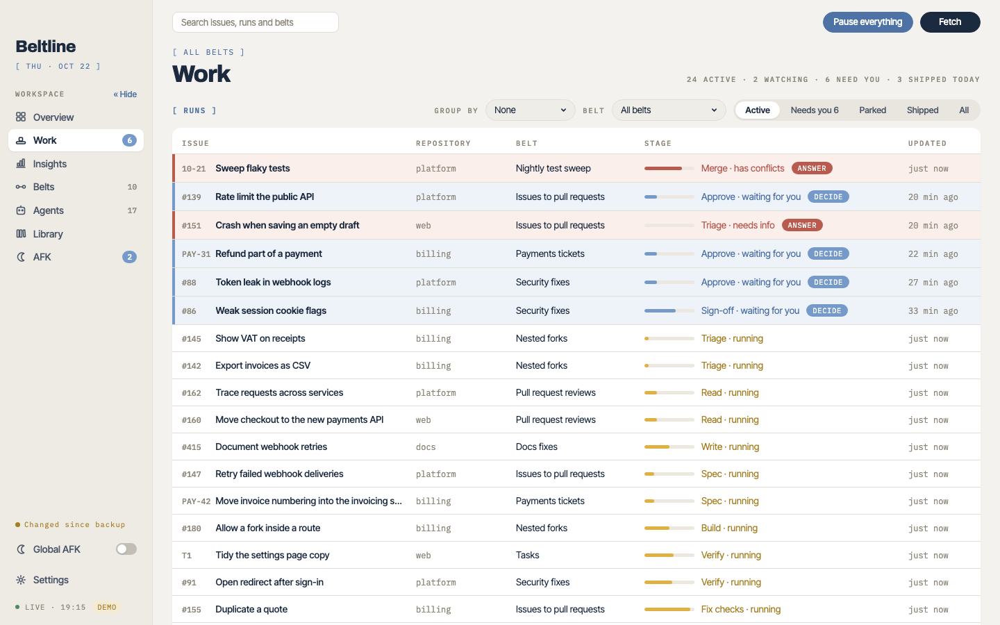

# Concepts

Beltline turns work items into pull requests by running them along **belts**. This section explains the parts and how a run moves along one.
{: .lead }

## The parts

**Belt**
: A trigger plus stages. Belts are saved as numbered versions, and a run finishes on the version it started on. See [Belts and triggers](belts.md).

**Trigger**
: What starts runs: GitHub issues with a label, pull requests that ask for your review, Jira tickets from a JQL query, a schedule, or tasks you start yourself.

**Stage**
: One step. An *agent* stage runs a coding agent CLI with a brief. An *approval* waits for you. A *watch* waits on the run's pull request, issue or ticket. See [Stages, outcomes and forks](stages.md).

**Outcome**
: The named result a stage ends with, such as *ready to spec*, *needs info* or *merged*. Each outcome says what happens next: the next stage, another stage, a route, run again, hold for you, park, done, ship or drop.

**Fork**
: A split of the belt into **routes**. The stage before a fork picks a route by its outcome, for example straight to Build for a small change, or through Spec first for a larger one.

**Run**
: One work item travelling along a belt. It keeps every attempt at every stage: the brief, the output, the transcript and your decisions. See [Working with runs](runs.md).

**Agent**
: A reusable definition in your library: a runner, a model, a brief and its outcomes, as one Markdown file. Stages pin an agent version, and runs keep copies of the versions they use. See [Agents](agents.md).

## How a run moves

1. **Intake.** The trigger finds a new work item, such as an issue that got the label, and starts a run on the belt's current version. The run copies that version's stages and policies, and the agent versions its stages pin, so later edits never change it.
2. **Stages.** The run enters the first stage. An agent stage starts a session in tmux, in a checkout the stage's *workspace* chooses. The agent writes its output file and ends it with an `Outcome:` line.
3. **Outcomes.** The engine reads the outcome and does what it says: move on, go back, take a fork's route, run again, or stop and hold for you.
4. **You.** A held run, an approval or a failed stage waits under **Needs you** until you decide. [AFK mode](afk.md) can decide for you while you're away.
5. **The end.** A watch waits for the pull request to merge. The run ends shipped, done, parked or dropped.

## Who does what

Agents make every outward change themselves, with `gh` and `acli`: pushes, pull requests, comments, labels, reviews and ticket moves. The built-in Ship, Post review and Wrap up agents do the usual ones. Beltline itself only reads GitHub and Jira, apart from a comment when a run is held (a [belt policy](belts.md#policies)) and the library repositories you configure. What an agent may do is what its brief and your belt allow; the [security model](security.md) explains what that means.

The daemon owns every fact and decision: which actions a run allows, whether a belt can be saved, every status and cost. The browser only shows what it's given, so two browsers on the same daemon never disagree.

## The pages

- **Overview**: a Summary (spend today, sessions, what's running, what shipped, what needs you) and a Floor with every belt as a lane, drawn as boxes, machines or a metro map, as **Settings → General** chooses.
- **Work**: every run, grouped and filtered, with the ones that need you highlighted.
- **Run**: one run's belt, each stage's output and your decisions, and its agent sessions live.
- **Belts** and **Agents**: searchable card grids of your library, each opening its editor.
- **Library**: your library repositories, to back up, restore, install and share. See [Library](library.md).
- **AFK**: the decisions AFK mode made, to check. See [AFK mode](afk.md).
- **Insights**: first-try rates, time and cost per stage. It's off until you turn on **Show the Insights page** in Settings → General. See [Insights](insights.md).
- **Settings**: tools, allowed models, AFK, library repositories, appearance and notifications.

**Spend** on the Overview totals the agent attempts that ended today. Copilot costs come from its cumulative usage checkpoints or shutdown report; a resumed attempt counts only the usage since it started. Cursor reports no usage.
