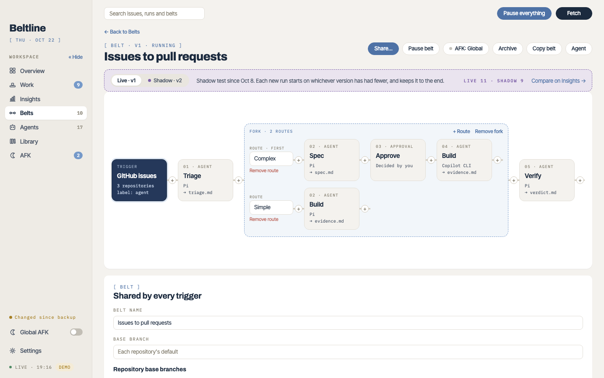

# Your first belt
{: .no_toc }

A fresh install has no belts and no agents. This page sets up a belt that turns issues labelled `agent` in one of your repositories into pull requests.
{: .lead }

1. TOC
{:toc}

## 1. Check the tools and allow models

Open **Settings → Tools** and check that `gh`, `git`, `tmux` and at least one agent CLI are found. Then open **Settings → Allowed models**. Beltline reads each runner's model catalog with its own sign-in, and you check the exact models agents may use. Fresh settings allow none, and a stage can't start without an allowed model. [Runners and models](runners.md) explains the choices.

## 2. Pick a label only you can apply

Agents read the issue text, and they run with their approval prompts turned off. Use a repository you own, and a label that only you or other maintainers can add. A label called `agent` is the default. Read the [security model](security.md) before you point a belt at a public repository.

## 3. Let the assistant write the belt

On **Belts**, open **Agent** and describe the belt you want, for example:

> A belt for issues labelled `agent` in owner/repo: triage, spec, an approval, build, verify, ship, then wait for the merge.

Choose the runner and model for the conversation and press **Start**. The configuration assistant is an agent session that writes the belt into your data folder, and asks you to install the agents it needs from the [examples library](library.md#the-examples-library). Every change it makes is a new version, and it asks before it archives, pauses or removes anything. See [Configure with an agent](configuration.md#configure-with-an-agent).

You can also build a belt by hand: **New belt** opens the editor with a trigger and no stages, and the **+** buttons between stages add agent, approval and watch stages.

## 4. Read the belt before you save

A typical issue belt looks like this:

| Stage | Kind | What it does |
| --- | --- | --- |
| Triage | agent | Reads the issue and the code. Ends in *ready to implement*, *ready to spec*, *needs info* or *wait to implement*. |
| Spec | agent | Writes a spec with numbered, testable behaviour rules. |
| Approve | approval | Waits for you to read the spec. |
| Build | agent | Implements the change in a worktree on the run's branch and commits it. |
| Verify | agent | Checks each spec rule against the change. |
| Ship | agent | Pushes the branch and opens the pull request. |
| Merge | watch | Waits for the pull request, then a fork sends the run to Wrap up, Resolve conflicts or Fix checks. |

Check the trigger's repositories and label, each agent stage's runner and model, and the outcomes of each stage: what *needs info* does, and where *blocking findings* sends the run. [Stages, outcomes and forks](stages.md) explains every choice. Save the belt.

## 5. Label an issue

Add the label to a small issue. Within a minute (the trigger polls every 60 seconds) the run appears on the **Overview** and on **Work**. Open it to follow each stage: the stage's output, the agent's live session in the **Sessions** sidebar, and what each outcome will do next.

When a run needs you, it's listed under **Needs you** on the Overview and on Work. Answer a held agent's questions, decide at an approval, or send the run to another stage. [Working with runs](runs.md) covers every action.

## Next

- Learn the vocabulary in [Concepts](concepts.md).
- Change what an agent does in [Agents](agents.md).
- Keep your belts and agents in git with [library repositories](library.md).
