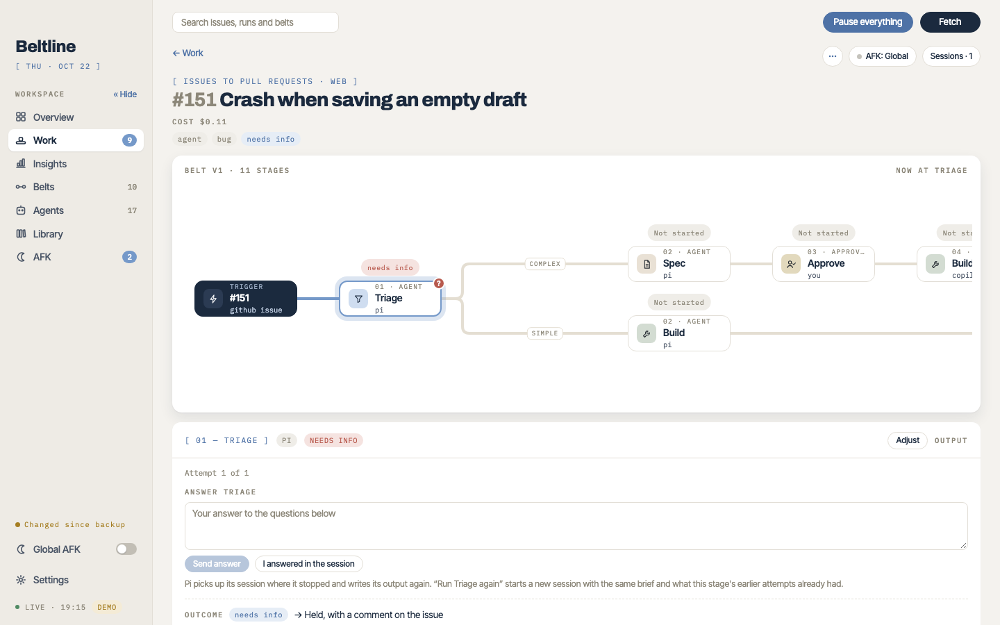

# Working with runs
{: .no_toc }

1. TOC
{:toc}

## The run page

A run's page shows its belt with the path it took: each stage's state, the route it took at each fork and the routes it didn't. Select a stage to see its attempts: the brief the agent got, its output, the outcome and what that outcome did next. The **Sessions** sidebar lists every agent session of the run and shows the selected one live, in a read-only terminal.

Runs that need you are listed under **Needs you** on the Overview and on Work, and Settings can send a browser notification when one arrives.

## Answering and deciding

- **A held agent** asked questions. Type your answer and **Send answer**: the same session picks up where it stopped and writes its output again. If you answered in the session's terminal yourself, choose **I answered in the session**.
- **An approval** waits for you to pick one of its outcomes. It shows the output leading into it, and what each outcome will make Beltline do.
- **A prompt stage** waits for you to write the run's task. Write in **Your prompt**, then choose an outcome; the work item's details are beside the editor for you to read. An outcome that moves the run on needs the prompt, and an outcome such as **Park it** doesn't. Your unsent prompt stays in this browser tab across reloads. If the run comes back to the stage, the editor starts from the task it has.
- **A failed stage** ended without a known outcome. Run it again, send the run elsewhere, or drop it.

### The task and source context

The prompt becomes the run's task, which every agent brief after the prompt stage carries, not only the next one. **Include source context for agents** decides what those briefs say about the work item:

- Unchecked (the prompt stage's default unless its belt says otherwise), agents get the work item's reference, such as `PAY-40` or `acme/billing#142`, and where its work starts and merges, but not its title, description, labels, parent or link, and they are told not to read them. The reference stays so Ship, Wrap up and Post review can still link the pull request, comment or move the ticket; the `{issue}` placeholder is the reference too. AFK decisions for the run see the same.
- Checked, agents get the work item's details as well, and the task wins where the two disagree.

The choice is saved on the run. It controls the briefs, not what an agent's tools can reach: branch names and folders still carry the reference, and text you copy into the prompt is always sent.

## Sending a run

On a held or parked run, **Send to…**, **Run … again** and **Unpark** open a sheet with an optional message:

- The message is saved on the new attempt and shown in its stage panel. Agents read it before they start; approvals and watches only record it. Later attempts don't inherit it.
- Sending to an agent stage includes that stage's earlier attempts by default. The sheet shows how many, and you can turn it off. The fresh session reads their notes and output paths, writes into a new attempt folder, and uses the run's current model and thinking for the stage.
- **Cancel** keeps your draft; **Send** clears it.

Answering a held session continues it with its recorded settings instead. Retries and redirects that outcomes make don't include earlier work.

## Adjusting a stage for one run

Select an agent stage on an active run and choose **Adjust** to change its harness, model, effort and brief for this run only. Model offers the choices that were allowed when the run started; **Use the agent's brief** restores the pinned agent's text. Adjustments are used from the next attempt on, without restarting a running session or changing earlier output. Shipped and dropped runs, approvals and watches can't be adjusted.

## Stopping, pausing and erasing

- **Abort…** stops the working agent and holds the run at its stage. Its branch, checkouts and drafts stay, and nothing outward changes. Answer it to continue the same session, or **Run … again** for a fresh one.
- **Pause** pauses one run: its place and conversations stay, and **Resume** continues interrupted sessions and restores queued work, watches and decision stops. **Pause belt** and **Pause everything** do the same for a belt or all of Beltline.
- **Drop** stops the run for good.
- **Erase…** removes the run, so its work item can be picked up again as a new run. Insights forgets it too.
- **Start now** starts a queued stage at once, past its stage's slots and a paused belt.

## Continuing a session yourself

**Continue** on a session in the Sessions sidebar opens it in the runner's own interactive interface, in a terminal you can type in. Use it to steer an agent by hand. Claude Code opens the same session, Codex resumes the checkout's newest session, and Cursor resumes its chat. You can also open the run's checkout in VS Code, Finder or Ghostty from the run's menu.

## Outputs and artifacts

Each attempt has its own folder in the data folder, with the brief, the output file and the transcript. Specs and other stage outputs live there, never in the repository's checkout, and briefs tell agents to use only the paths they're given. `(no spec.md yet)` in a brief means this run hasn't produced that output.

The output an agent wrote shows as one document, with its title and then one section per heading. Each section's heading is a button: click it, or press Enter or Space on it, to open or close that section alone, and several can stay open. Sections start closed. A heading at any level starts its own section, so a subsection opens without its parent, and a repeated heading gets its own control. Text before the first heading sits under an **Output** section, and an output with no headings is one such section. Open questions still moves up under the title, as the daemon orders it. Approval documents, prompts and the outcome and artifacts stay as they were. Each browser remembers which sections you opened, per run and attempt, so they are open again when you come back to that attempt; clearing the browser's site data closes them all again. Other browsers start closed.

An agent or stage brief that uses `{artifacts}` asks the agent for optional standalone `.html` files in the attempt's `artifacts/` folder, outside the checkout. The stage panel lists them, with **Open in browser** and **Show in Finder**; nothing opens by itself. Agent-written HTML can run scripts and reach the network when you open it. The [security model](security.md#the-local-server) explains how the daemon serves it.
