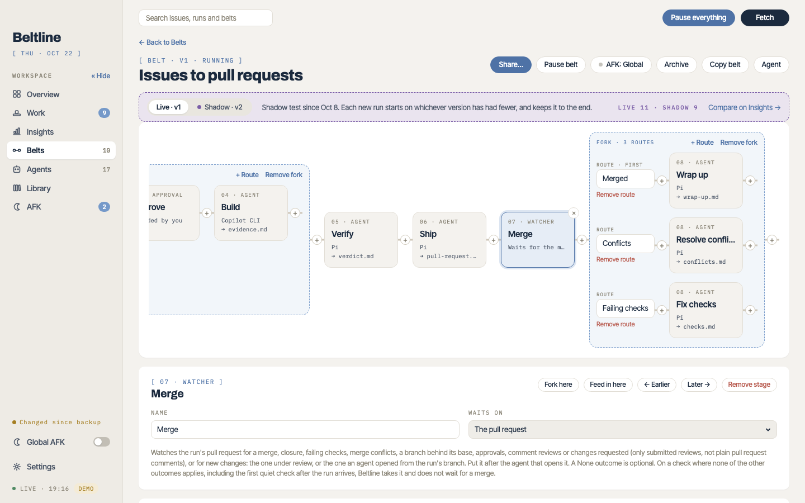

# Stages, outcomes and forks
{: .no_toc }

1. TOC
{:toc}

## Three kinds of stage

**Agent**
: Runs a coding agent CLI (Claude Code, Codex CLI, Copilot CLI, Cursor CLI or Pi) in a tmux session with a brief. The agent writes an output file and ends it with an `Outcome:` line. Agents do everything outward themselves, such as pushing, opening the pull request, commenting or moving a ticket.

**Approval**
: Waits for you. It shows the latest agent output leading into it, such as the spec, and what each of its outcomes will do, for example *Approve means Beltline will: have Build run, have Verify check the change, open the pull request*. You pick the outcome.

Put Approval first to ask for permission before any agent runs. Set the belt's [AFK mode](afk.md) to **Never** when only you may approve.

**Watch**
: Waits on the run's pull request, or on its own issue or ticket, and ends in an outcome when something happens there. See [Watches](watches.md).

## Agent stage settings

An agent stage pins one version of an agent from your library and starts with its settings. The stage can change them for this belt:

| Setting | What it does |
| --- | --- |
| **Workspace** | Where the agent works: a *read-only checkout of the base branch* (triage, spec, review), a *worktree* on the run's branch it may commit to (build, ship), or the run's worktree *read-only* (verify). |
| **Runs at once** | How many runs may be at this stage at the same time (its slots). Others queue. |
| **Harness, model and thinking** | Which agent CLI (the *runner*) runs the stage, with which allowed model and thinking level. See [Runners and models](runners.md). |
| **Add a model** | Alternates: other runner, model and thinking settings that fresh sessions are spread across, to compare models. A run that comes back to the stage keeps the one it had, and Insights ranks them. |
| **Placeholder** | The stage's key, which names its output file (`spec.md`) and the placeholder later briefs use for it (`{spec}`). |
| **Brief** | Extra text for this stage, or the agent's brief as it is. See [Briefs and placeholders](agents.md#briefs-and-placeholders). |
| **When the stage fails** | The fallback when a session fails or ends without a known outcome: hold for you (the default), run again once, or drop the run. |

**Update stage** takes a newer version of the stage's agent, and **Update all stages** takes the newest of every agent on the belt.

## Outcomes

Every stage ends in one of its outcomes. An outcome has a **name** (the agent writes `Outcome: ready to spec`), a **when** that tells the agent when to choose it, a **tone**, and a **then**: what happens next.

| Tone | Means |
| --- | --- |
| Good | Things went as hoped. Insights counts a first try with a good outcome as passing. |
| Needs you | A person has to look. |
| Problem | Something went wrong. |
| Neutral | Neither, such as *wait to implement*. |

| Then | What happens |
| --- | --- |
| **Next stage** | Move on to the next stage. Past the last stage, the run is done. |
| **Go to a stage** | Send the run to another stage, earlier or later. *With output* hands this stage's output to it as a note, and *at most N times* stops a loop: past the limit, the run holds. |
| **Take a route** | Take one route of the fork right after this stage. |
| **Run again** | Run this stage again, at most N times. |
| **Hold for me** | Stop and wait for you. *Comment* also posts the agent's questions on the issue, pull request or ticket. |
| **Park** | Set the run aside, such as an issue that isn't ready yet. **Unpark** picks it up again. |
| **Done** | End the run's route successfully. |
| **Ship** | End it successfully and record that the work shipped. |
| **Drop** | Stop the run. |

An agent copies one of the outcome lines its brief lists into its output file. When the output has no known outcome, the stage's fallback applies.

## Forks and routes

A **fork** splits the belt into routes. The stage before the fork picks a route through its outcomes' **Take a route**. For example, Triage's *ready to implement* takes the Simple route straight to Build, and *ready to spec* takes the Complex route through Spec, an approval and Build. Each route has its own stages; when a route's last stage moves on, the run rejoins the line after the fork. A run keeps the route it took at each fork.

In the editor:

- **Fork here** adds a fork after the selected stage, with the line as its first route. **+ Route** adds another.
- **Feed in here** puts a fork in front of the selected stage whose route nothing on the line splits into. Only a **Go to a stage**, or **Send to…** on a run, reaches it. The fork after a watch uses this: Resolve conflicts and Fix checks sit on routes of their own and go back to the watch.
- A **Go to a stage** into a fork names one target per route, and the run takes the one on the route it's on.

Forks can nest: a route can hold a fork of its own.

## Saving

Saving checks the whole belt, and refuses what wouldn't run: an outcome without a target, a stage whose inputs no trigger provides, a placeholder no stage defines, a model that isn't allowed, or a thinking level the runner doesn't take. The editor lists each problem at the stage it belongs to. Some problems are only warnings: you can save, and the belt stays paused until they're resolved.
